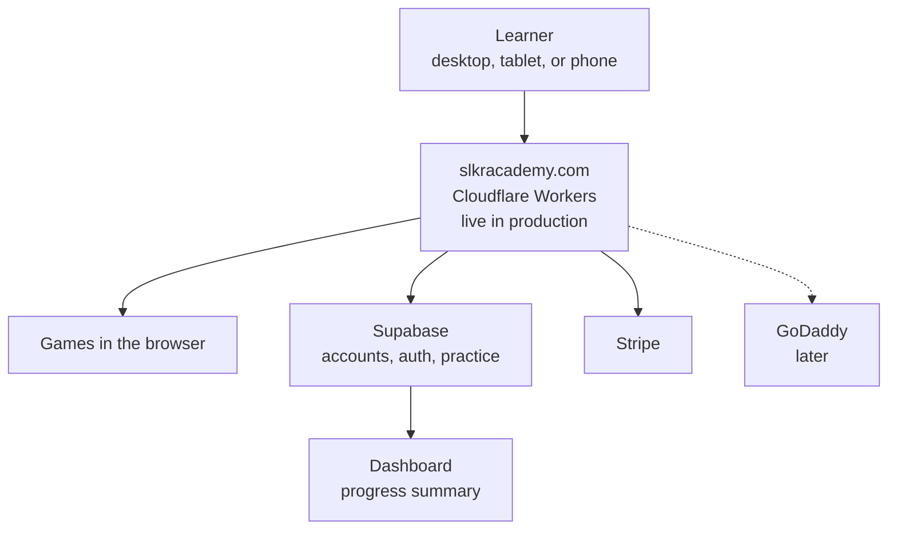

# SLKR Academy architecture

How [slkracademy.com](https://slkracademy.com) is hosted. It is live in production. Limits below are from Cloudflare and Supabase’s published plans as of November 2026.

## What it is

SLKR Academy is a learning suite for children in Kindergarten through Grade 5, run by SLKR Entertainment LLC. It is live in production at [https://slkracademy.com](https://slkracademy.com). One subscription covers reading, math, science, and thinking.

It is cross-platform. The same app runs in the browser on desktop, tablet, and phone. Keyboard and touch both work. There is nothing to download, and there is no separate app for each device.

Each session generates a new question. A wrong answer opens a tutor that walks the solution. Practice time and those help steps are saved to the account. Progress is tracked and summarized on the dashboard page.

Cloudflare hosts the app. Supabase holds accounts and practice data. Stripe handles billing.

## Architecture

The learner opens the same site on a computer, tablet, or phone. Cloudflare serves it. The games run in the browser. Supabase stores the account and the practice. The dashboard summarizes that progress. Stripe bills the subscription. GoDaddy is a later option, shown with a dashed line.

Game files are static, so they do not count toward the Workers request cap. Account calls and saved sessions do.

## Cloudflare Workers

The free plan includes **100,000 requests a day**, shared by every Worker on the account. That fits a small audience. Past the cap, Cloudflare returns error 1027.

Each request also gets 10 milliseconds of CPU. That is enough to save an account. It is tight if the tutor runs on the Worker.

The paid plan is $5 a month and includes 10 million requests a month. Limits: [Cloudflare Workers](https://developers.cloudflare.com/workers/platform/limits/).

## GoDaddy later

GoDaddy is the later host if the app needs a normal always-on server. Shared hosting can serve the site. A VPS is the step that adds CPU and memory as traffic grows.

## Supabase

Supabase handles the data, the accounts, and auth. The free plan includes **50,000 monthly active users**. An active user is someone who signs in that month.

The tighter free limits are a 500 MB database and a pause after a week with no activity. Pro starts at $25 a month when those get in the way. Plans: [Supabase pricing](https://supabase.com/pricing).

## This versus EKS

EKS is Amazon’s Kubernetes service. The learner would still use the browser, and progress would still land on the dashboard. The difference is the server. This app runs as a short Worker on Cloudflare. EKS runs containers that stay up in a cluster you help operate.

| | This app | EKS |
| --- | --- | --- |
| Compute | A Worker per request | Pods in a cluster |
| Quiet months | Free, or $5 on the paid plan | Cluster, nodes, and a load balancer stay billed |
| Database and accounts | Supabase, already in place | Often moved to AWS as well |
| Long jobs | Short CPU budget per request | Pods can run longer work |

For long-term scaling, migrate to GoDaddy and Supabase. EKS fits later, if the tutor cannot finish inside a Worker or the academy becomes several always-on services. Until then a cluster costs more to run than traffic needs. 
