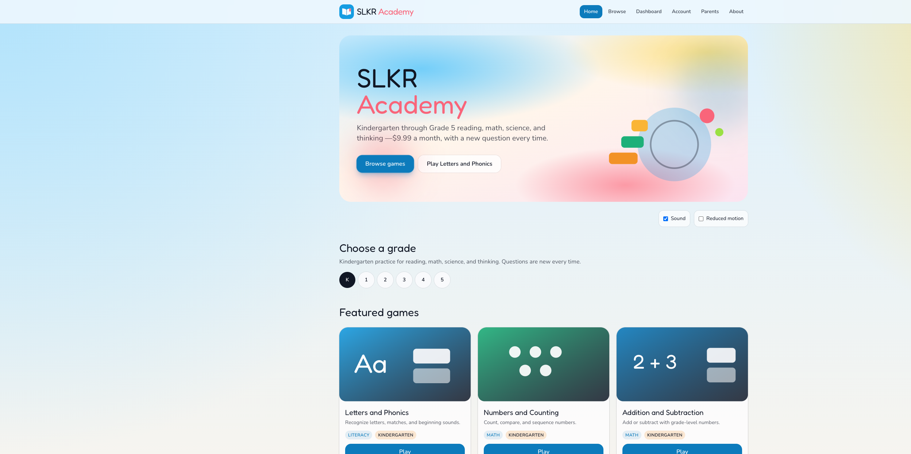
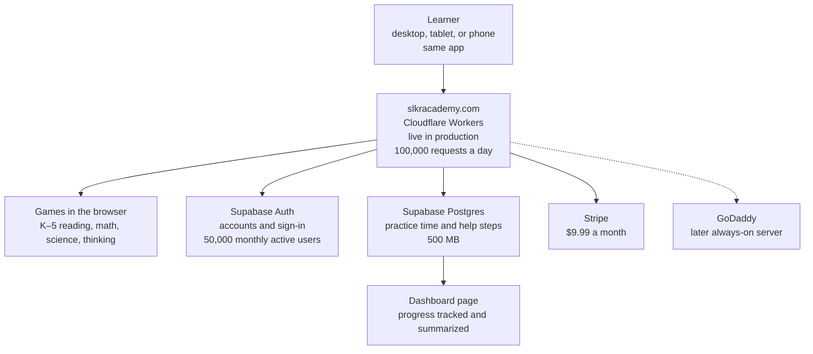
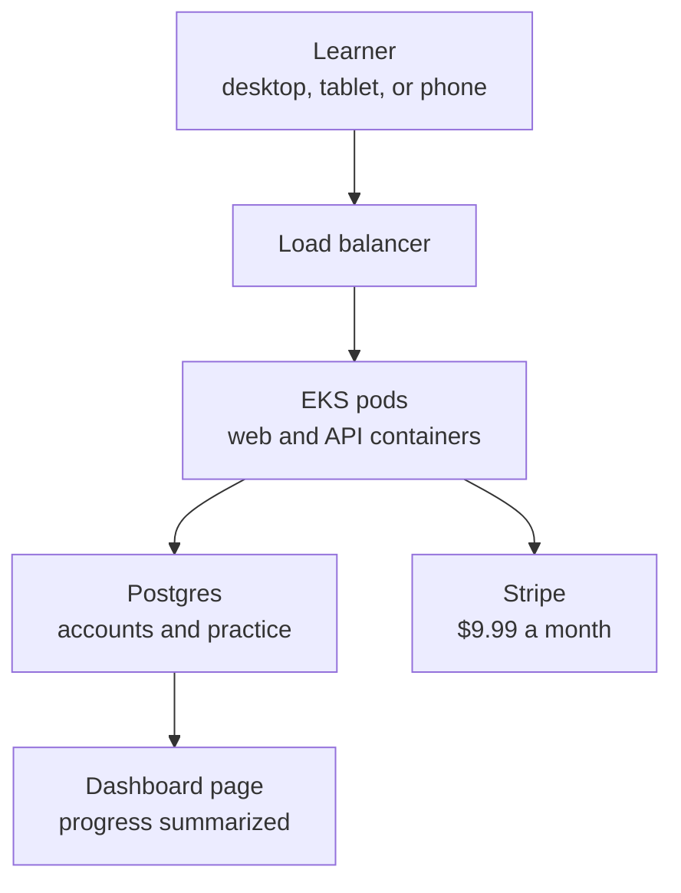

# SLKR Academy architecture

How [slkracademy.com](https://slkracademy.com) is put together, and why the free tiers are enough while the audience is still small. The site is live in production. Limits below are from Cloudflare and Supabase’s published plans as of November 2026.

## What it is

SLKR Academy is a learning suite for children in Kindergarten through Grade 5, run by SLKR Entertainment LLC. It is live in production at [slkracademy.com](https://slkracademy.com). One subscription, $9.99 a month, covers reading, math, science, and thinking.

It is cross-platform. The same app runs in the browser on desktop, tablet, and phone. Keyboard and touch both work. There is nothing to download, and there is no separate app for each device.

Each session generates a new question. A wrong answer opens a tutor that walks the solution. Practice time and those help steps are saved to the account. Progress is tracked and summarized on the dashboard page.

The screenshot is the live homepage at [slkracademy.com](https://slkracademy.com), taken November 7, 2026. It shows the grade picker (Kindergarten through Grade 5) and the featured games for the selected grade.

The live split is already stated on the site: Cloudflare hosts the app, Supabase holds accounts, and Stripe handles billing. Support is slkrentertainmentllc@aol.com.

Pages in production: Home, Browse, Dashboard, Account, Parents, About, Privacy, and Terms.

## Architecture

A learner opens the live site on a desktop, tablet, or phone. Cloudflare Workers serves the same app to all three. The games run in the browser. Sign-in, accounts, and saved practice go to Supabase. Progress is tracked there and summarized on the dashboard page. Stripe charges the $9.99 monthly plan. GoDaddy is the later server, drawn as a dashed path because it is not in the production path.

Static files (HTML, scripts, and artwork) are served by Workers and do not count toward the daily request cap. What counts is work the Worker runs: account calls, saving a session, and anything else that executes on the server.

## Cloudflare Workers free tier

The free plan includes **100,000 requests per day**, shared by every Worker on the account. The counter resets at midnight UTC. Past that, Cloudflare returns error 1027.

That allowance fits a small application. A few hundred families after school, or a handful of classrooms trying the product, stay well under 100,000 Worker requests a day when the games themselves are static files. The daily cap is the signal that the audience has grown past this plan.

Two other free-plan limits sit beside the request cap:

- **10 milliseconds of CPU** per request. Enough for a thin handler that reads or writes an account. Tight if question generation or the tutor moves into the Worker.
- **128 MB** of memory, **50 subrequests** per invocation, and up to **100 Workers** on the account.

The app is already on Cloudflare, deploys to their network, and costs nothing while the subscriber list is short. A real school rollout, or a heavy in-Worker tutor, is what would trip the free plan.

Published limits: [Cloudflare Workers limits](https://developers.cloudflare.com/workers/platform/limits/) and [pricing](https://developers.cloudflare.com/workers/platform/pricing/).

## GoDaddy for long-term scaling

GoDaddy is the host to use once the free Worker cap, or the 10 ms CPU cap, is no longer enough and the product needs a normal always-on server.

GoDaddy’s ladder is shared web hosting, then a VPS, then a dedicated server. Shared hosting can serve this HTML5 site and a small backend. A VPS is the step that scales it: your own CPU and memory, room for the app process, and a plan you upgrade as traffic grows. The bill becomes a monthly server, in place of a daily request counter.

That move is a platform change, so it waits until the audience is real. The domain can stay wherever it is registered. Email and the Stripe subscription stay as they are. What changes is where the app runs: a GoDaddy server you control, sized up when classrooms and families outgrow 100,000 Worker requests a day.

If the only problem is the daily cap, Cloudflare’s Workers paid plan is the nearer step: $5 a month, 10 million requests a month included, then $0.30 per extra million, and a much higher CPU ceiling. GoDaddy is the longer-term choice when the goal is a conventional server.

## Supabase

Supabase is the data layer: Postgres for saved practice, plus accounts and auth. Practice time and help steps are stored here, and progress is tracked and summarized on the dashboard page. Stripe stays the billing system.

On the free plan, auth includes **50,000 monthly active users**. An active user is someone who signs in or refreshes a session during that billing month. A family that subscribed in September and does not open the app in November does not count for November. Accounts can exist beyond 50,000. The free quota is how many of them show up in a month.

50,000 active learners in a month is far past a small launch. At $9.99 each, that is a real business, and the auth line on the free plan still covers it.

The limits that will matter sooner:

| Free plan | Included |
| --- | --- |
| Monthly active users | 50,000 |
| Database | 500 MB Postgres, shared CPU, 500 MB RAM |
| File storage | 1 GB |
| Egress | 5 GB, plus 5 GB cached |
| Active projects | 2 |
| Idle projects | Paused after 1 week with no activity |

Practice rows are small, so 500 MB holds a lot of sessions. It is still the number to watch, because every saved attempt and help step lands in that database. Egress is the other one if the client pulls large reads on every game. A quiet week in production would pause the free project until someone wakes it.

Pro starts at $25 a month, raises the included auth quota to 100,000 monthly active users, and stops pausing the project for inactivity. That is the upgrade when the database, egress, or the pause gets in the way. The 50,000-user auth allowance can stay free well past the point where the database needs a paid plan.

Published plans: [Supabase pricing](https://supabase.com/pricing).

## How the free tiers fit

Cloudflare serves the academy. Supabase remembers who the learner is and what they practiced. Stripe charges $9.99 a month.

While the audience is families and a few classrooms, both free tiers cover the product. Workers’ 100,000 requests a day cover the traffic. Supabase’s 50,000 monthly active users cover the accounts, with 500 MB of database as the earlier ceiling. GoDaddy is the long-term server for when that daily Worker allowance, or the need for a normal host, outgrows the free plan.

## This architecture versus EKS

EKS is Amazon Elastic Kubernetes Service. It is the other shape people reach for when a small app needs to grow: a Kubernetes cluster on AWS, with the site and the API packaged as containers. This academy does not run on EKS. The comparison is what would change if it did.

On EKS the learner still opens a browser. A load balancer sends traffic into the cluster. Pods serve the app and save practice. A database holds accounts and progress. Stripe still charges $9.99 a month. The dashboard still summarizes progress. The product split stays the same. The machine underneath it does not.

They are similar in the places the learner can see:

- The same app runs in the browser on desktop, tablet, and phone.
- Accounts, practice, and billing stay off the device.
- Progress is stored and summarized on the dashboard.
- More learners means more compute and a larger database, and both designs can add that capacity.
- Stripe stays a separate billing system in either design.

They differ in how the compute is run:

| | This architecture | EKS |
| --- | --- | --- |
| What runs the app | Cloudflare Workers, one short run per request, at the edge | Containers kept running as pods in a Kubernetes cluster |
| Who operates it | Cloudflare runs the platform. A deploy updates the Worker. | AWS runs the control plane. You run deployments, ingress, node capacity, and cluster upgrades. |
| Static games | HTML, scripts, and artwork are served as static assets and do not count toward the 100,000 daily requests. | You serve those files from the pods, or you add object storage and a CDN yourself. |
| How it grows | More requests, then the Workers paid plan. The database grows on Supabase. | More pods, then more nodes. The database is usually a separate Postgres service in the same cloud. |
| How long work can run | Free plan allows 10 ms of CPU per request. Paid Workers raise that ceiling. | Pods can run longer jobs, queues, and several services side by side. |
| What you pay when it is quiet | The free plan is $0. Paid Workers starts at $5 a month. | The cluster has a control-plane charge every hour it exists, plus nodes and a load balancer, including hours with no learners. |
| Data and auth | Supabase is already the database, the accounts, and the auth. | Moving to EKS often also means moving Postgres and auth onto AWS. That is a second migration. |

## Which is best for long-term scaling

For this product, Cloudflare Workers and Supabase are the better long-term scale path. The games already run in the browser. Growth shows up as more requests and more saved practice, which is what those two services bill for. The Workers paid plan raises the request cap to 10 million a month and lifts the CPU ceiling. Supabase Pro raises the database size, the egress, and removes the one-week pause. That pair scales a browser academy a long way before a cluster is useful.

EKS is the better long-term host when the academy becomes several always-on services: a tutor that cannot finish inside a Worker, background jobs, or a team running many backends in one cluster. Until then the cluster’s monthly control plane, nodes, and upgrades cost more to operate than the traffic requires.

GoDaddy and EKS are different later steps. GoDaddy is one conventional server you size up. EKS is a container cluster. For a single cross-platform browser app with saved progress and Stripe, paid Workers plus Supabase Pro is the scaling step that matches the architecture already in production.
